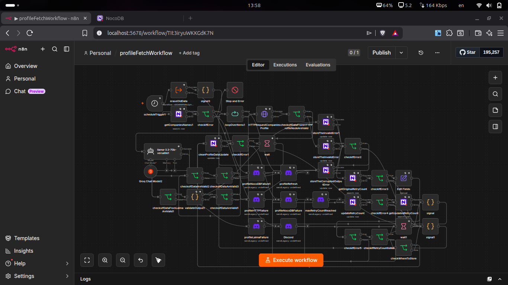
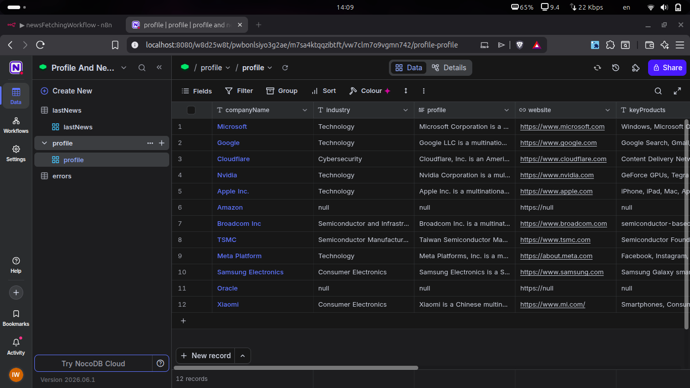
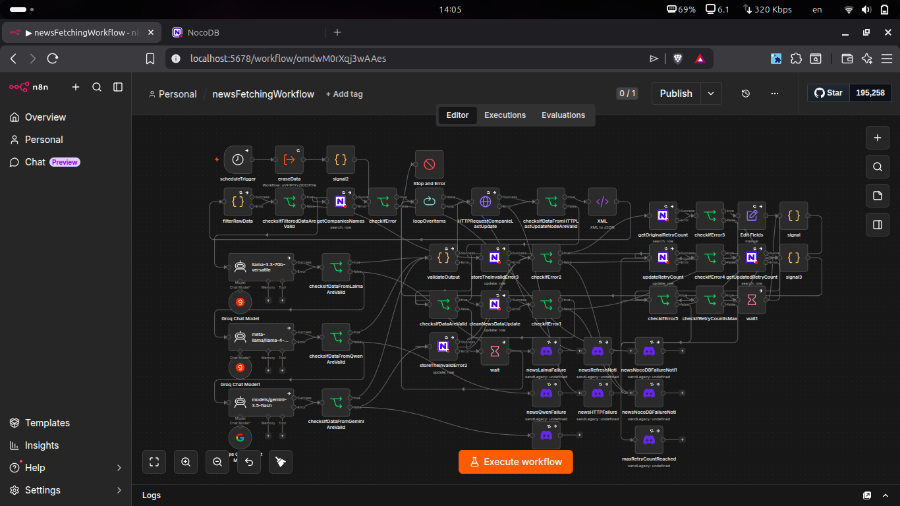
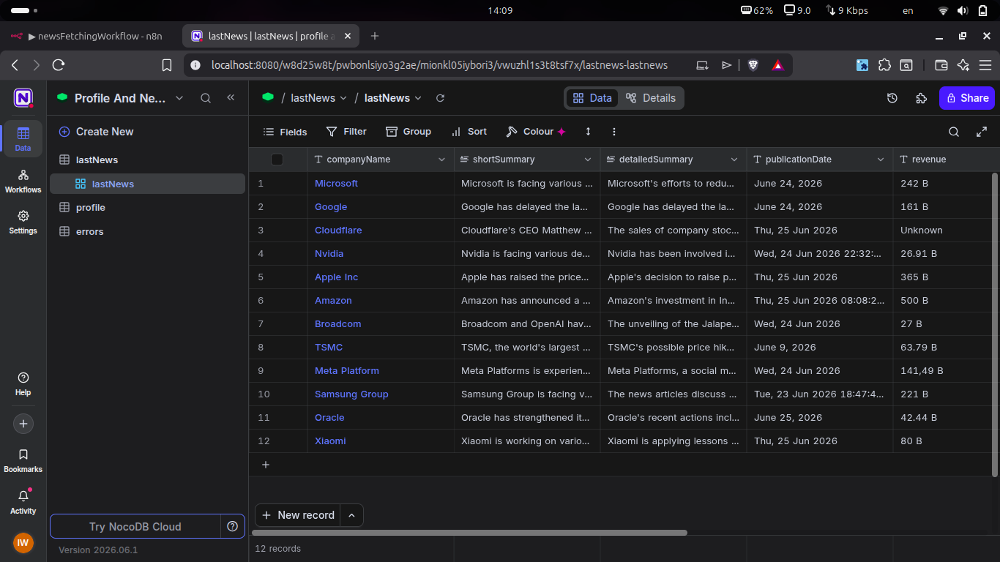
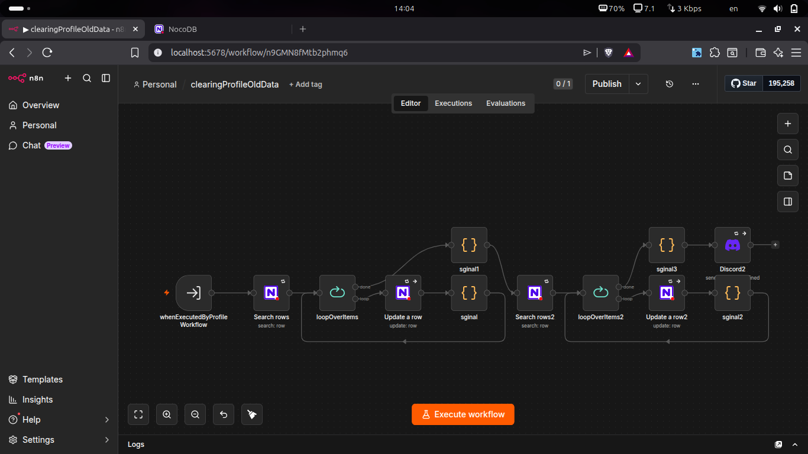
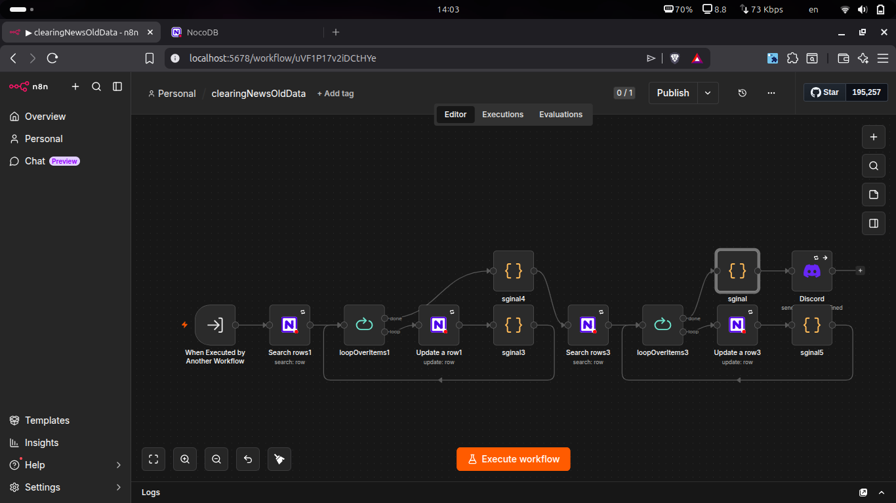
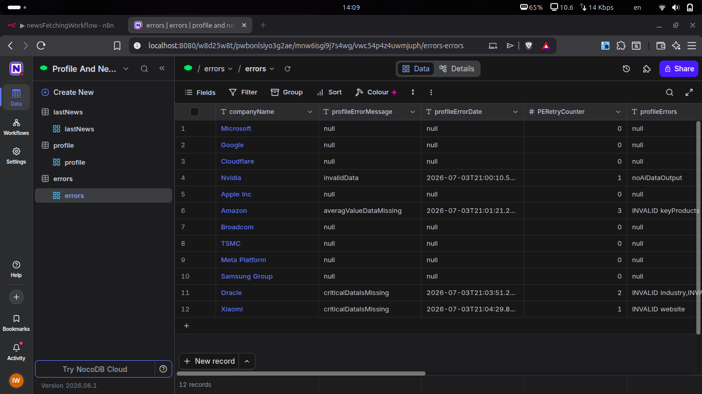

# Company Intelligence


A containerized full-stack enterprise intelligence platform that automatically collects, analyzes, and aggregates latest news and company profile data in real-time. Built with **Docker**, **n8n**, **NocoDB**, and **FastAPI**.

## Overview

Company Intelligence is designed to help you monitor and analyze company information seamlessly. The system runs two main automated workflows:

- **News Fetching Workflow**: Continuously collects the latest news related to your companies
- **Profile Fetching Workflow**: Gathers and updates company profile data including industry, competitors, key products, and tags

With robust error handling, multi-model AI fallback support, and containerized deployment, this platform can run anywhere Docker is available.

## Screenshots

### Profile Data

**n8n Workflow**



**NocoDB Table**



### News Data

**n8n Workflow**



**NocoDB Table**



### Data Cleanup Workflows





### Error Logging



## Key Features

- **Automated Workflows**: n8n-powered workflows for continuous data collection and analysis
- **Multi-AI Model Support**: Built-in fallback nodes for multiple AI model API keys (3+ models supported)
- **Robust Error Handling**: Comprehensive error logging and tracking with CSV error reports
- **Real-Time Data Aggregation**: Centralized data management with NocoDB
- **Docker Containerized**: Run the entire stack with a single `docker-compose` command
- **Scalable Architecture**: Ready for expansion with FastAPI backend and frontend dashboard

## Architecture

```
Company Intelligence Platform
├── n8n (Workflow Orchestration)
|   ├── Clearing Old News Data Workflow
│   ├── News Fetching Workflow
│   ├── Clearing Old Profile Data Workflow
|   └── Profile Fetching Workflow
├── NocoDB (Database & UI)
│   └── Centralized Data Storage
|      ├── News Table
|      ├── Profile Table
|      └── Errors Table
├── FastAPI Backend (Server Side)
|   ├── NocoDB Client For Fetching Data
│   └── FastAPI app: Processing/Displaying
└── Frontend Dashboard (User Interface)
    └── Interactive Data Visualization
```

### Data Collected

**Company Profiles**:

- Company name
- Industry
- Website
- Profile information
- Competitors
- Tags
- Key Products

**Company News**:

- Latest news articles
- Timestamps
- Sources
- Analysis & insights

**Error Tracking**:

- Failed data fetches
- Processing errors
- API failures

## Quick Start

### Prerequisites

- **Docker & Docker Compose** - [Install Docker Desktop](https://docs.docker.com/get-docker/) (includes Compose, works on Windows/macOS/Linux)
- **Python 3.10+** - [Install from python.org](https://www.python.org/downloads/) (needed to run the FastAPI backend outside Docker)
- API Keys for AI models (OpenAI, Gemini, Groq, etc.)
- NocoDB API token

### Installation

1. **Clone the repository**:

   ```bash
   git clone https://github.com/iwaneth/CompanyIntelligence.git
   cd CompanyIntelligence
   ```

2. **Set up environment variables**:

   ```bash
   cp .env.example .env
   ```

3. **Configure your API keys in `.env`**:

   ```env
   # Example configuration:
   openAi > Gemini > groq

   # NocoDB Configuration
   NOCODB_API_TOKEN=your_nocodb_token_here
   NOCODB_BASE_URL=http://nocodb:8080
   ```

4. **Start the platform**:

   ```bash
   docker-compose up -d
   ```

5. **Access the services**:
   - **n8n Workflows**: http://localhost:5678
   - **NocoDB Database**: http://localhost:8080

### Post-Setup Configuration

#### Configure n8n Workflows

1. Access n8n at `http://localhost:5678`
2. Import workflows from workflow.example/ in the repository:
   - `newsFetchingWorkflow.json` - For automated news collection
   - `profileFetchWorkflow.json` - For automated profile data refresh
   - `clearingNewsOldData.json` - For erasing old news data
   - `clearingProfileOldData.json` - For erasing old Profile Data

3. Configuration:

- In fetching workflows:

* configure the AI model nodes with your API keys:
* Set primary AI model credentials
* Configure fallback nodes with alternative API keys for resilience

- For all workflows:

* Link NocoDB credentials for data persistence
* Link discord webhook token for getting notification on failures (optional, if you don't want to link it you have to remove the discord nodes before)

#### Connect NocoDB

1. Access NocoDB at `http://localhost:8080`
2. Import tables from workflow.example/ in the repository:

- `profile and news - lastNews.csv`
- `profile and news - profile.csv`
- `profile and news - errors.csv`

3. Generate and copy your NocoDB API token
4. Add to n8n workflows for data persistence

#### Back-end Starter

1. Make sure Python 3.10+ is installed (see Prerequisites above).
2. Open the project folder and set up a virtual environment:

```bash
cd 'path to the folder'
python3 -m venv venv
source ./venv/bin/activate
```

3. Install dependencies:

- ```bash
  pip install -r requirements.txt
  ```

4. Run the app with uvicorn:

- ```bash
  uvicorn app:app --host 127.0.0.1 --port 8000
  ```

5. Access the page:

- to see server status and health: http://127.0.0.1:8000/
- to see the home page (displaying page): http://127.0.0.1:8000/dashboard

## Project Structure

```
CompanyIntelligence/
├── demos/
|   └── ...                             # demo screenshots
├── static/
|  ├── styles4.css                      # css styles conf
|  └── walhaven-vqd8j8.jpg              # example wallpaper
├── templates/
|   └── HomePage.html                   # html displaying page
├── workflow.example/
|  ├── clearingNewsOldData.json         # n8n workflow for news old data erasing
|  ├── newsFetchingWorkflow.json        # n8n workflow for news collection
|  ├── clearingProfileOldData.json      # n8n workflow for profile old data erasing
|  ├── profileFetchWorkflow.json        # n8n workflow for profile refreshing
|  ├── profile and news - profile.csv   # Sample profile data
|  ├── profile and news - lastNews.csv  # Sample news data
|  └── profile and news - errors.csv    # Errors logs
├── .env.example                        # environment variables
├── .gitignore                          # Git ignore rules
├── README.md                           # This file
├── app.py                              # FastAPI app
├── CONTRIBUTING.md                     # This file
├── docker-compose.yml                  # Docker services configuration
├── LICENSE                             # permissions
├── nocodb_client.py                    # NocoDB client
├── requirements.txt                    # This file
├── SECURITY.md                         # This file
└── test_app.py                         # Testing FastAPI server
```

## Configuration Details

### AI Model Fallback System

The system supports up to 3+ AI model APIs with automatic fallback:

1. **Primary Model**: Your main AI service (e.g., OpenAI)
2. **Fallback Model 1**: Secondary service (e.g., Anthropic Claude)
3. **Fallback Model 2**: Tertiary service (e.g., Groq, or others)

If the primary model fails, the workflow automatically uses the fallback models to ensure continuous operation.

### Error Handling & Logging

All errors are automatically logged to `profile and news - errors.csv` with:

- Timestamp of error
- Error type
- Failed operation
- Company/data affected
- Suggested resolution

Monitor this file to identify patterns and improve workflows.

## Data Flow

```
Companies List
    ↓
n8n Workflows (News & Profile)
    ↓
AI Models (with fallbacks)
    ↓
Data Processing & Validation
    ↓
NocoDB Database
    ↓
FastAPI Backend (Server Side)
    ↓
Frontend Dashboard (User Interface)
```

## Troubleshooting

### Workflows not running?

- Check n8n container logs: `docker logs n8n_local`
- Verify all API keys are correctly configured
- Ensure NocoDB token is valid and has proper permissions

### Data not appearing in NocoDB?

- Verify NocoDB service is running: `docker ps`
- Check NocoDB connection credentials in n8n
- Ensure database tables exist in NocoDB

### AI Model failures?

- Check API key validity for all configured models
- Monitor error logs in `profile and news - errors.csv`
  -- Verify fallback nodes are properly configured with alternative API keys

### Docker issues?

- Pull latest images: `docker-compose pull`
- Rebuild containers: `docker-compose up -d --build`
- Check Docker disk space: `docker system df`

## Roadmap

### Phase 1 (Done)

- ✅ n8n workflow orchestration
- ✅ Multi-model AI support with fallbacks
- ✅ NocoDB database integration
- ✅ Error handling & logging

### Phase 2 (Current)

- FastAPI backend development
  - REST API endpoints for data access
  - Data filtering and search capabilities
  - Rate limiting and authentication

### Phase 3 (In Progress)

- Frontend Dashboard
  - Real-time data visualization
  - Interactive company monitoring
  - News feed and alerts

### Phase 4 (Future - v2)

- Multi-user system
- User authentication & authorization
- Personalized dashboards
- Email notifications
- Custom alerts & filters

## Contributing

Contributions are welcom! See [CONTRIBUTING.md](CONTRIBUTING.md) for details.

## Dependencies

- **Docker & Docker Compose**: Containerization
- **n8n**: Workflow automation platform
- **NocoDB**: Open-source database platform with UI
- **FastAPI**: Modern Python web framework (backend)
- **Multiple AI APIs**: OpenAI, Anthropic, Groq, etc.

## Support

For issues, questions, or suggestions:

- Check the troubleshooting section above
- Review error logs in CSV files
- Check n8n and NocoDB documentation

---

**Started in 28/05/2026 and still goes in rate of 6 hours a day**

Last Updated: July 2026
